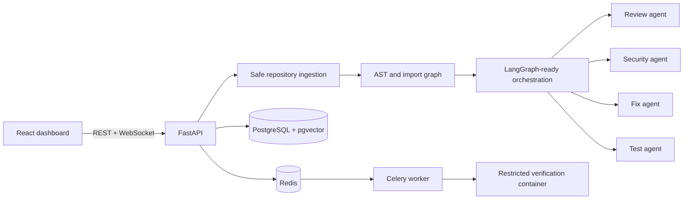

# Architecture

The MVP keeps the local zero-configuration path durable in `data/runs.json`, while Compose provisions PostgreSQL/pgvector and Redis for the production migration path. Repository code is read for indexing but never imported or executed by the API. Proposed patches are verified against an isolated representation and do not change the cloned repository.

## Data flow

1. The API validates HTTPS GitHub URLs and creates a run.
2. A shallow, blob-filtered clone is placed below the controlled workspace, or the bundled deterministic sample is generated.
3. Bounded source files are parsed into file/function/import nodes.
4. Review agents emit evidence-backed, typed findings.
5. The dashboard receives status snapshots and displays graph, evidence, metrics, and traces.
6. Patch approval triggers verification; applying changes to a user repository is intentionally out of scope.

## Security boundaries

- Host and path are allow-listed; shell interpolation is never used for Git arguments.
- File sizes, source extensions, clone depth, and execution time are bounded.
- API keys remain server-side and evidence redacts likely credentials.
- Containers drop Linux capabilities and disallow privilege escalation.
- Untrusted repository code must only be tested with the sandbox image using a read-only source mount, disabled network, CPU/memory/PID limits, and a timeout.

Remaining risks include malicious Git object decompression, parser denial of service, symlink handling, and incomplete language parsing. Production deployments should add an egress-denied clone service, admission policy, authentication, tenant isolation, object storage, audit logs, and a container runtime sandbox such as gVisor.

